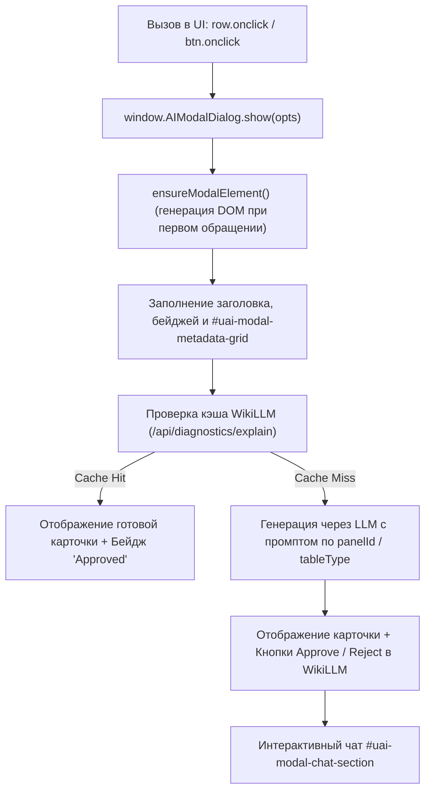

# Навык: Универсальное модальное окно ИИ-ассистента (AI Modal Dialog)

## 📌 Назначение и концепция

Универсальное модальное окно ИИ-ассистента (`#universal-ai-table-modal`) — ключевой компонент WebGUI в проекте **AI Windows Admin**. Оно обеспечивает сквозной контекстный анализ любых системных сущностей Windows (процессов, сетевых подключений, сессий питания, событий журналов аудита, служб, дисков, ключей реестра и файлов) с многоуровневой архитектурой:

1. **L1 Exact Cache (WikiLLM / SQLite)**: мгновенный возврат верифицированных экспертных карточек без ожидания обращения к LLM.
2. **Contextual LLM Explanation**: генерация структурированного ответа (роль, издатель, оценка безопасности, влияние на производительность, шаги администратора) через Gemini / OpenAI / Ollama / Foundry.
3. **Web Grounding**: онлайн-проверка фактов в сети для верификации цифровых подписей, официальных репозиториев и назначения программ.
4. **Follow-up Chat (Gemini Streaming)**: интерактивный чат внутри модального окна для уточняющих вопросов оператора.
5. **Изолированные промпты по панелям и сущностям**: привязка шаблонов промптов и системных инструкций к конкретному `panelId` и `tableType` с поддержкой мультиязычности (i18n).

---

## 🏗️ Архитектура и DOM-структура

Модальное окно инкапсулировано в динамически создаваемый контейнер `#universal-ai-table-modal` и вспомогательное окно `#universal-ai-prompt-editor-modal`.



### 1. Основные DOM-элементы `#universal-ai-table-modal`

| Селектор | Назначение | Описание |
|---|---|---|
| `#uai-modal-icon` | Иконка сущности | Эмодзи или SVG (`👤`, `🛡️`, `⚡`, `📡`, `⚙️`) |
| `#uai-modal-title` | Главный заголовок | Название процесса, аккаунта, ID сессии питания |
| `#uai-modal-badges` | Контейнер бейджей | Статусы, PID, протоколы, типы завершения |
| `#uai-modal-metadata-grid` | Сетка ключевых метаданных | Табличный блок пар «Ключ — Значение» в 2 колонки |
| `#uai-modal-ai-section` | Карточка ИИ-анализатора | Блок сгенерированного ответа модели |
| `#uai-modal-web-status` | Индикатор Web Grounding | Бейдж активности онлайн-поиска |
| `#toggle-auto-enrich-on-miss` | Чекбокс авто-обогащения | Авто-вызов LLM при отсутствии записи в WikiLLM |
| `#btn-uai-modal-edit-prompt` | Кнопка настройки промпта | Открывает модалку редактора для текущей панели |
| `#btn-uai-modal-refresh` | Кнопка повторного анализа | Принудительный перезапуск анализа с обходом кэша |
| `#uai-modal-ai-explanation` | Контейнер карточки ответа | Рендерит секции: резюме, издатель, безопасность, производительность, рекомендации |
| `#uai-modal-chat-section` | Интерактивный чат с ИИ | Чат-сессия по анализируемой сущности |
| `#uai-chat-messages-container` | История сообщений чата | Список реплик пользователя и ответов ИИ |
| `#uai-chat-quick-buttons` | Быстрые вопросы оператора | Кнопки предзаданных частых вопросов |
| `#uai-chat-input` | Поле ввода вопроса | Текстовый инпут |
| `#uai-chat-send-btn` | Кнопка отправки сообщения | Отправка сообщения в модель |
| `#collapseRawData` | Спойлер сырых данных | Сворачиваемый блок с JSON или XML телеметрией |
| `#collapseDevAdvice` | Спойлер советов разработчику | Сворачиваемый блок технической документации и интерактивных скриптов (`developer_advice`) |
| `#collapseSysInstruction` | Спойлер системной инструкции | Панель быстрой правки системной инструкции модели |
| `#btn-toggle-dev-advice` | Кнопка спойлера разработчика | Переключает видимость блока советов разработчику |
| `#uai-modal-panel-badge` | Бейдж текущей панели | Показывает текущий `panelId` (например, `panel-system-control-4`) |
| `#uai-modal-type-badge` | Бейдж типа таблицы | Показывает текущий `tableType` (например, `power_session`) |
| `#uai-modal-approval-box` | Блок аппрува в WikiLLM | Кнопки подтверждения и добавления в доверенную базу |

### 2. Модальное окно редактора `#universal-ai-prompt-editor-modal`

Позволяет администратору на лету настроить промпт для конкретной панели или глобально для типа таблицы:
- Поля: Название, Описание, Системная инструкция (`system_instruction`), Шаблон промпта (`prompt_template`).
- Доступные переменные шаблона:
  - `{title}` — заголовок сущности;
  - `{subtitle}` — подзаголовок / контекст;
  - `{metadata}` — форматированный список метаданных;
  - `{raw_data}` — тело сырых данных / телеметрии.
- Сохранение: раздельно по `panel_id` или `table_type` в `apps/windows/prompts/diagnostics/<id>.json`.
- Сброс: возврат к исходному заводскому шаблону.

---

## 🔌 Интеграция в WebGUI

### 1. Подключение ресурсов в `index.html` или модуль вкладки

Скрипт модального окна регистрируется как синглтон в глобальном объекте `window`:

```html
<!-- Стили модального окна -->
<link rel="stylesheet" href="/html/ai_modal_dialog/style.css?v=20261015_v1">

<!-- Контроллер модального окна -->
<script src="/html/ai_modal_dialog/main.js?v=20261015_v1"></script>
```

> [!IMPORTANT]
> Модальное окно автоматически экспортирует в глобальную область видимости два алиаса:
> - `window.AIModalDialog` (основной класс-синглтон)
> - `window.AITableModal` (обратная совместимость)

DOM-элементы создаются лениво (lazy creation) при первом вызове `show()` или `open()`, поэтому жестко вставлять HTML-разметку модального окна в каждую страницу **не требуется**.

---

## 💻 Справочник JavaScript API

### Метод `window.AIModalDialog.show(options)`

Главный универсальный метод открытия модального окна для любой строки таблицы или системной сущности.

#### Сигнатура параметров `options`:

```javascript
window.AIModalDialog.show({
  // 1. Идентификация и визуализация
  icon: '⚡',                                 // Иконка (эмодзи или символ)
  title: 'Сессия питания: #14',              // Главный заголовок
  subtitle: 'Статус: Shutdown | 02:45:10',   // Подзаголовок
  
  // 2. Изоляция и привязка промптов (КРИТИЧНО!)
  panelId: 'panel-system-control-4',         // Уникальный ID панели UI
  tableType: 'power_session',                // Нормализованный тип сущности

  // 3. Плашки и бейджи (в шапке модалки)
  badges: [
    { text: 'Normal Shutdown', class: 'badge bg-success' },
    { text: 'Kernel-Power', class: 'badge bg-primary' }
  ],

  // 4. Сетка метаданных (Key-Value)
  metadata: [
    { label: 'ID сессии', value: '14' },
    { label: 'Время старта', value: '2026-10-15 08:00:00' },
    { label: 'Время завершения', value: '2026-10-15 10:45:10' },
    { label: 'Аптайм', value: '2 ч 45 мин' },
    { label: 'Инициатор', value: 'C:\\Windows\\System32\\shutdown.exe', fullWidth: true }
  ],

  // 5. Сырые данные телеметрии (для спойлера)
  rawTitle: 'Хронология событий питания',
  rawContent: JSON.stringify(sessionData, null, 2),

  // 6. Контекст для передачи в LLM /explain эндпоинт
  requestData: {
    session_id: 14,
    events_count: 5,
    events: [...]
  },

  // 7. Пользовательские кнопки действий в футере (опционально)
  actions: [
    {
      label: 'Экспорт журнала',
      icon: 'bi-download',
      class: 'btn-outline-info',
      onClick: (item) => exportSessionLog(item)
    }
  ]
});
```

---

### Метод `window.AIModalDialog.open(program, name, pid, ...)`

Специализированный хелпер для быстрого открытия досье процесса по его имени и идентификатору:

```javascript
window.AIModalDialog.open(
  'chrome.exe',       // Имя программы
  'Google Chrome',    // Читаемое имя
  12844,              // PID
  8512,               // Parent PID
  'C:\\Program Files\\Google\\Chrome\\Application\\chrome.exe', // Путь
  '--type=renderer ...' // Командная строка
);
```

---

### Метод `window.AIModalDialog.openPromptEditor(tableType, panelId)`

Открывает модальное окно прямого редактирования промпта:

```javascript
// Открыть редактор для конкретной панели
window.AIModalDialog.openPromptEditor('power_session', 'panel-system-control-4');
```

---

## ⚙️ Механизм разрешения промптов и мультиязычность (i18n)

### Приоритет поиска шаблона (`DiagnosticsPromptManager.get_template`):

```
1. panel_id (если передан):
   ├── 1.1. Кастомный JSON на диске: apps/windows/prompts/diagnostics/{panel_id}.json
   └── 1.2. Базовый шаблон DEFAULT_PROMPTS[panel_id]
2. table_type:
   ├── 2.1. Кастомный JSON на диске: apps/windows/prompts/diagnostics/{table_type}.json
   └── 2.2. Базовый шаблон DEFAULT_PROMPTS[table_type]
3. Fallback:
   └── Универсальный шаблон DEFAULT_PROMPTS['generic']
4. Применение локали i18n:
   └── template.for_language(lang) (ru, en, etc.)
```

### Поддерживаемые типы сущностей (`tableType`):

- `process` — процессы и драйверы ядра Windows;
- `power_session` — сессии питания и жизненного цикла ПК;
- `power_event` — события питания Kernel-Power / сбои / BSOD;
- `user_account` — учетные записи пользователей и групп;
- `security_event` — события журнала аудита безопасности;
- `network` — сокеты, сетевые соединения и адаптеры;
- `service` — системные службы Windows;
- `task` — задачи планировщика Task Scheduler;
- `disk` — накопители, тома и SMART телеметрия;
- `startup` — объекты автозагрузки;
- `help` — контекстная справка и документация по архитектуре;
- `app_log` — логи внутренних приложений и трейсы ошибок;
- `generic` — базовый системный аудит.

---

## 🖱️ Стандарты событий UI и эргономика вызова (UX Guidelines)

Для обеспечения строгого единообразия во всем веб-интерфейсе **AI Windows Admin** действуют следующие правила вызова ИИ-ассистента:

### 1. Вызов строго по событию `onclick` на строке таблицы
- Модальное окно ИИ-ассистента вызывается **исключительно по одиночному клику (`onclick`) на строке таблицы** (`<tr class="..." style="cursor: pointer;">`).
- **КАТЕГОРИЧЕСКИ ЗАПРЕЩЕНО** размещать кнопки вызова ИИ (`<button class="..."><i class="bi bi-robot"></i> ИИ</button>`) внутри ячеек строк таблицы (`<td>`). Колонка действий резервируется исключительно для системных операций (завершить процесс, сбросить сессию, удалить запись).
- **КАТЕГОРИЧЕСКИ ЗАПРЕЩЕНО** использовать событие двойного клика (`dblclick` / `ondblclick`) для открытия модального окна. Двойной клик на вебе неочевиден, создает задержки и ломает интуитивную навигацию.

### 2. Позиционирование иконки Drill-Down (красная дрель `/html/assets/red_drill.png`)
- Если таблица поддерживает режим углубленного технического профилирования (Drill-Down / Process Deep Dive):
  - Иконка красной дрели **ОБЯЗАТЕЛЬНО** размещается в **первой колонке таблицы слева** (перед всеми остальными колонками: PID, именем, статусом).
  - Заголовок первой колонки: `<th style="width: 36px; text-align: center;" title="Drill-down: Детальный анализ сущности"></th>`.
  - Ячейка строки:
    ```html
    <td class="text-center no-modal-trigger" style="width: 36px;" onclick="event.stopPropagation();">
      <button type="button" class="btn-drilldown-proc pm-btn-drilldown" data-pid="${item.pid}" title="Drill-Down: 🔬 Process Intelligence Deep Dive">
        
      </button>
    </td>
    ```
  - Клик по кнопке дрели вызывает открытие углубленного виджета с обязательной изоляцией клика (`event.stopPropagation()`), чтобы не открывать одновременно ИИ-модалку строки.

### 3. Изоляция интерактивных элементов внутри строки
- В обработчике клика по строке таблицы всегда предусматривается защита от ложных срабатываний:
  ```javascript
  row.addEventListener('click', (e) => {
    // Не открывать модалку при клике по кнопкам действий, ссылкам, инпутам или шевронам
    if (e.target.closest('button, a, input, select, .no-modal-trigger, .pm-chevron')) return;
    openAiModalForItem(item);
  });
  ```

### 4. Единый источник правды (Запрет изолированных дубликатов модальных окон)
- Все вызовы ИИ-анализа в любых вкладках должны направляться строго в глобальный синглтон:
  ```javascript
  const modal = window.AIModalDialog || window.AITableModal || (window.parent && (window.parent.AIModalDialog || window.parent.AITableModal));
  modal.show({ ... });
  ```
- Категорически запрещено создавать локальные копии модальных окон (старые паттерны `#pm-process-ai-modal`, `#principalDossierModal` и т.д.). Любой старый мусорный код модалок подлежит полному удалению.

---

## 🛠️ Чек-лист разработчика при интеграции модального окна

При добавлении модального окна в новую вкладку или панель **ОБЯЗАТЕЛЬНО** проверить:

1. [ ] Модальное окно открывается по `onclick` на всей строке `<tr>`, а не по кнопке в ячейке `<td>`.
2. [ ] Отсутствуют любые обработчики `dblclick` / `ondblclick` на строках таблицы.
3. [ ] Иконка красной дрели (Drill-Down), если присутствует, расположена в первой колонке таблицы слева.
4. [ ] В ячейке красной дрели и интерактивных элементах строки предусмотрен `event.stopPropagation()`.
5. [ ] Указан **уникальный** `panelId` (например, `panel-process-manager-dispetcher-protsessov-i-prilozhen`, `panel-winadmin-users`).
6. [ ] Указан **соответствующий** `tableType` (`process`, `user_account`, `network`, `service`, etc.).
7. [ ] В `metadata` переданы понятные администратору поля с человекочитаемыми метками на русском языке.
8. [ ] В `requestData` передан чистый контекстный объект записи для корректной подстановки в `{raw_data}`.
9. [ ] Отсутствуют локальные дублирующие модальные окна в разметке HTML.

