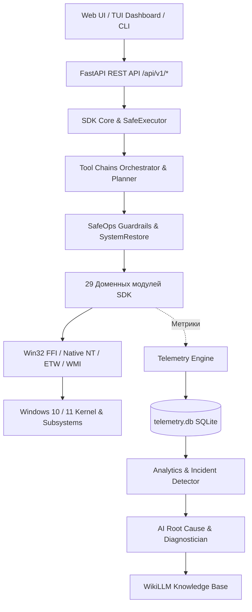
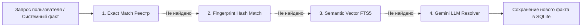

<!-- Updated: 2026-10-10 16:35:00 -->
# 🪟 Каталог инструментов подсистемы Windows (`apps/windows`)

Комплексный справочник и реестр инструментов, доменных модулей, низкоуровневых FFI-интерфейсов, аналитических движков, AI-агентов и CLI/TUI утилит, входящих в состав архитектурного стека `apps/windows`.

---

## 📑 Содержание

1. [Архитектурный обзор и принцип работы](#-архитектурный-обзор)
2. [CLI и TUI интерфейсы (Точки входа)](#1-cli-и-tui-интерфейсы)
3. [Ядро SDK, оркестраторы и цепочки инструментов (SDK Core & Tool Chains)](#2-ядро-sdk-и-оркестраторы-sdk-core)
4. [Динамический реестр инструментов для AI-агентов](#3-динамический-реестр-инструментов-для-ai-агентов)
5. [Доменные модули SDK (29 функциональных подсистем)](#4-доменные-модули-sdk-29-подсистем)
6. [Слой телеметрии и аналитики (Telemetry & Analytics)](#5-слой-телеметрии-и-аналитики)
7. [WikiLLM — Прогрессивная база знаний и индексатор кода](#6-wikillm--база-знаний-и-индексатор)
8. [Log Intelligence & Adaptive RAG](#7-log-intelligence--adaptive-rag)
9. [AI Diagnostics & Root Cause Analysis](#8-ai-diagnostics--root-cause-analysis)
10. [Низкоуровневые Win32 FFI & Native API обёртки](#9-низкоуровневые-win32-ffi--native-api)
11. [REST API маршрутизаторы (FastAPI Routers)](#10-rest-api-маршрутизаторы)
12. [Системные каталоги и реестры возможностей](#11-системные-каталоги-и-реестры)

---

## 💡 Архитектурный обзор

Подсистема `apps/windows` построена по принципу **многоуровневого контура безопасности и сквозного аудита**:
* **Низкоуровневый слой (Win32 FFI, Native API, WMI, ETW, CLI):** собирает детерминированные факты и сырую телеметрию без побочных эффектов.
* **Доменный слой (SDK Modules):** изолированные микромодули управления конкретными подсистемами ОС (диски, службы, сеть, безопасность, реестр, панель задач).
* **Слой безопасности и исполнения (SafeOps):** классификация рисков (Tier 1–6), Dry-Run симуляция, предварительное создание контрольных точек (System Restore).
* **Слой цепочек инструментов (Tool Chains Orchestrator):** интеллектуальное планирование, многошаговое исполнение с динамическим ветвлением, компенсация сбоев и журналирование в SQLite.
* **Слой телеметрии и аналитики:** сбор, агрегация и хранение в `telemetry.db`, исторический анализ отказов и аномалий.
* **Интеллектуальный слой (AI & WikiLLM):** многоуровневое разрешение сущностей, корреляция первопричин (Root Cause), генерация рекомендаций и авторемедиация в замкнутом контуре.



---

## 1. CLI и TUI интерфейсы

| Инструмент / Модуль | Команда запуска | Описание |
|---|---|---|
| **Главный Windows CLI** | `python -m apps.windows` или `py apps/windows/cli.py` | Универсальная командная строка для запуска аудитов, диагностики, отчётов и системных проверок. |
| **Оркестратор цепочек (CLI)** | `python -m apps.windows --chain-intent "<запрос>"` | Семантическое планирование и пошаговый запуск цепочки инструментов по запросу на естественном языке. |
| **Каталог шаблонов цепочек** | `python -m apps.windows --chain-list` | Вывод списка готовых диагностических и восстановительных шаблонов цепочек. |
| **Запуск цепочки по ID** | `python -m apps.windows --chain-run <ID> [--chain-dry-run]` | Запуск конкретной цепочки (например `diag.network.port_availability`) с поддержкой безопасного режима Dry-Run. |
| **Windows TUI Dashboard** | `python -m apps.windows.tui` | Полноэкранный интерактивный дашборд на Rich/Textual с мониторингом метрик, процессов и сенсоров. |
| **WikiLLM CLI** | `python -m apps.windows.wikillm` | Поиск по базе знаний, индексация кодовой базы, аудит команд и синонимов. |
| **WikiLLM TUI** | `python -m apps.windows.wikillm.tui` | Интерактивный терминальный интерфейс для исследования графа знаний и сущностей Windows. |
| **Telemetry Analytics CLI** | `python -m apps.windows.telemetry.analytics.cli` | Извлечение метрик из `telemetry.db`, анализ перезагрузок, аудит железа и инцидентов. |
| **System Inspector TUI** | `python -m apps.windows.sdk.modules.sysadmin.tui` | Аудит пользователей, мониторинг директорий и контроль целостности файлов. |
| **Taskbar Manager TUI** | `python -m apps.windows.sdk.modules.taskbar.core.manager` | Управление панелью задач, окнами и виртуальными рабочими столами. |
| **Storage Manager TUI** | `python -m apps.windows.sdk.modules.storage_manager.tui` | Управление дисками, запуск экспресс-бенчмарка DiskSpd и низкоуровневое клонирование. |
| **Task Scheduler TUI** | `python -m apps.windows.sdk.modules.task_scheduler.tui` | Инспекция и управление запланированными заданиями Task Scheduler. |
| **Checkpoints TUI** | `python -m apps.windows.sdk.modules.system_checkpoints.tui` | Управление точками восстановления Windows и средой WinRE. |

---

## 2. Ядро SDK и оркестраторы (`apps/windows/sdk/core`)

| Компонент / Файл | Класс / Функция | Назначение |
|---|---|---|
| [`tool_chains/engine.py`](file:///c:/Users/onela/AppData/Local/AI-TC/apps/windows/sdk/core/tool_chains/engine.py) | `ToolChainExecutionEngine` | Исполнительный движок цепочек инструментов с защитой SafeOps, динамическим ветвлением, компенсацией и протоколированием. |
| [`tool_chains/planner.py`](file:///c:/Users/onela/AppData/Local/AI-TC/apps/windows/sdk/core/tool_chains/planner.py) | `ToolChainPlanner` | Семантический планировщик графа шагов из естественно-языкового намерения пользователя. |
| [`tool_chains/storage.py`](file:///c:/Users/onela/AppData/Local/AI-TC/apps/windows/sdk/core/tool_chains/storage.py) | `ToolChainStorage` | SQLite хранилище шаблонов цепочек, истории запусков, вызовов инструментов и доказательств. |
| [`tool_chains/catalog.py`](file:///c:/Users/onela/AppData/Local/AI-TC/apps/windows/sdk/core/tool_chains/catalog.py) | `get_builtin_chains` | Встроенный каталог типовых цепочек (диагностика портов, расследование SSD, безопасный перезапуск служб). |
| [`safe_executor.py`](file:///c:/Users/onela/AppData/Local/AI-TC/apps/windows/sdk/core/safe_executor.py) | `SafeExecutor` | Движок безопасного исполнения команд с поддержкой Dry-Run, валидацией рисков и созданием бэкапов. |
| [`root_cause_engine.py`](file:///c:/Users/onela/AppData/Local/AI-TC/apps/windows/sdk/core/root_cause_engine.py) | `RootCauseEngine` | Построение графа инцидентов и расследование первопричин сбоев по временным шкалам. |
| [`correlation_engine.py`](file:///c:/Users/onela/AppData/Local/AI-TC/apps/windows/sdk/core/correlation_engine.py) | `CorrelationEngine` | Междоменная корреляция событий (CPU + EventLog + Disk IO + Network Drops). |
| [`diagnostics.py`](file:///c:/Users/onela/AppData/Local/AI-TC/apps/windows/sdk/core/diagnostics.py) | `DiagnosticsEngine` | Комплексный расчёт индекса здоровья системы (Health Score) по 10+ категориям. |
| [`agent_loop.py`](file:///c:/Users/onela/AppData/Local/AI-TC/apps/windows/sdk/core/agent_loop.py) | `WindowsAgentLoop` | Автономный цикл ReAct для AI-агента с пошаговым вызовом системных инструментов. |
| [`atomic_capabilities.py`](file:///c:/Users/onela/AppData/Local/AI-TC/apps/windows/sdk/core/atomic_capabilities.py) | `AtomicCapabilityRegistry` | Реестр атомарных системных операций с маппингом привилегий и рисков. |
| [`system32_catalog.py`](file:///c:/Users/onela/AppData/Local/AI-TC/apps/windows/sdk/core/system32_catalog.py) | `System32Catalog` | Семантический каталог 149 штатных системных утилит Windows System32. |
| [`closed_loop_remediation.py`](file:///c:/Users/onela/AppData/Local/AI-TC/apps/windows/sdk/core/closed_loop_remediation.py) | `RemediationCoordinator` | Замкнутый контур автоматического исправления проблем с валидацией результата. |
| [`etw_pipeline.py`](file:///c:/Users/onela/AppData/Local/AI-TC/apps/windows/sdk/core/etw_pipeline.py) | `EtwPipeline` | Конвейер захвата и потоковой обработки низкоуровневых событий ETW в реальном времени. |
| [`focus_executor.py`](file:///c:/Users/onela/AppData/Local/AI-TC/apps/windows/sdk/core/focus_executor.py) | `FocusExecutor` | Управление фокусом приложений, подавлением уведомлений и политиками тишины. |
| [`power_monitor.py`](file:///c:/Users/onela/AppData/Local/AI-TC/apps/windows/sdk/core/power_monitor.py) | `PowerMonitor` | Мониторинг состояний питания, батареи, схем электропитания и сна. |
| [`process_activity_engine.py`](file:///c:/Users/onela/AppData/Local/AI-TC/apps/windows/sdk/core/process_activity_engine.py) | `ProcessActivityEngine` | Аналитика активности процессов, переключения контекста и использования ресурсов. |
| [`process_audit_manager.py`](file:///c:/Users/onela/AppData/Local/AI-TC/apps/windows/sdk/core/process_audit_manager.py) | `ProcessAuditManager` | Глубокий аудит запущенных процессов, проверка цифровых подписей и путей запуска. |
| [`software_transparency.py`](file:///c:/Users/onela/AppData/Local/AI-TC/apps/windows/sdk/core/software_transparency.py) | `SoftwareTransparencyManager` | Построение матрицы прозрачности ПО: связь Приложение → Служба → Драйвер → Задача. |
| [`system_restore.py`](file:///c:/Users/onela/AppData/Local/AI-TC/apps/windows/sdk/core/system_restore.py) | `SystemRestoreManager` | Управление точками восстановления VSS и автоматическое создание бэкапа перед операциями. |
| [`system_param_manager.py`](file:///c:/Users/onela/AppData/Local/AI-TC/apps/windows/sdk/core/system_param_manager.py) | `SystemParamManager` | Чтение и модификация системных параметров Windows (реестр, переменные среды, политики). |

---

## 3. Динамический реестр инструментов для AI-агентов (`apps/windows/sdk/core/tools`)

| Файл | Назначение | Описание |
|---|---|---|
| [`registry.py`](file:///c:/Users/onela/AppData/Local/AI-TC/apps/windows/sdk/core/tools/registry.py) | `ToolRegistry` | Центральный реестр инструментов, поддерживающий регистрацию, валидацию и фильтрацию по ролям. |
| [`dynamic_factory.py`](file:///c:/Users/onela/AppData/Local/AI-TC/apps/windows/sdk/core/tools/dynamic_factory.py) | `DynamicToolFactory` | Фабрика автоматической генерации JSON-схем и сигнатур инструментов для LLM на основе сигнатур Python. |
| [`system_tools.py`](file:///c:/Users/onela/AppData/Local/AI-TC/apps/windows/sdk/core/tools/system_tools.py) | `SystemToolsProvider` | Набор готовых системных инструментов (чтение реестра, управление службами, запуск CLI, сбор метрик). |
| [`base.py`](file:///c:/Users/onela/AppData/Local/AI-TC/apps/windows/sdk/core/tools/base.py) | `BaseTool`, `ToolResult` | Базовые абстракции, модели входных/выходных данных и статус выполнения инструмента. |

---

## 4. Доменные модули SDK (29 подсистем)

Расположены в [`apps/windows/sdk/modules`](file:///c:/Users/onela/AppData/Local/AI-TC/apps/windows/sdk/modules):

| № | Модуль | Основные классы / Функционал | Назначение |
|---|---|---|---|
| 1 | **`hardware`** | `HardwareManager`, `GPUProber`, `CpuSensor` | Мониторинг температур, напряжений, тактовых частот и сенсоров через LibreHardwareMonitor / WMI. |
| 2 | **`network`** | `NetworkManager`, `LanScanner`, `SpeedtestRunner` | Сетевая телеметрия, сканирование локальной сети, замер пропускной способности, открытые сокеты. |
| 3 | **`storage_manager`** | `StorageManager`, `DiskSpdBenchmark`, `RawCloner` | Разметка накопителей, низкоуровневое посекторное клонирование, бенчмарк DiskSpd, SMART. |
| 4 | **`services_manager`** | `ServicesManager`, `Win32ServiceController` | Управление службами Windows, обнаружение осиротевших сервисов, анализ триггеров запуска. |
| 5 | **`process_manager`** | `ProcessManager`, `ProcessInspector` | Мониторинг и управление процессами, деревья процессов, лимиты памяти, приостановка/завершение. |
| 6 | **`task_scheduler`** | `TaskSchedulerManager`, `TaskFolderTree` | Инспекция, создание, включение/отключение и аудит запланированных заданий Task Scheduler. |
| 7 | **`taskbar`** | `TaskbarManager`, `TaskbarListCOM`, `VirtualDesktop` | Управление панелью задач через COM ITaskbarList, манипуляция окнами, бейджи, прогресс-бары. |
| 8 | **`defender`** | `DefenderManager`, `MpCmdRunHelper` | Мониторинг Microsoft Defender, запуск сканирования, исключения, статус защит в реальном времени. |
| 9 | **`firewall_manager`** | `FirewallManager`, `FwRuleAuditor` | Управление правилами брандмауэра Windows, открытие/блокировка портов, аудит профилей. |
| 10 | **`registry`** | `RegistryManager`, `RegistrySearchEngine` | Чтение, запись, аудит веток реестра (HKLM, HKCU), безопасный экспорт и откат изменений. |
| 11 | **`startup`** | `StartupManager`, `StartupAuditor`, `PrefetchScanner` | Анализ автозагрузки (Registry, Startup Folders, Task Scheduler, RunOnce) и расчёт задержки старта. |
| 12 | **`system_checkpoints`**| `CheckpointCoordinator`, `WinREManager`, `Freshness` | Управление точками восстановления VSS, аудит их свежести и интеграция со средой WinRE. |
| 13 | **`boot_recovery`** | `BootRecoveryManager`, `BcdEditor` | Управление конфигурацией загрузки BCD, Safe Mode, восстановление EFI и параметров bootrec. |
| 14 | **`backup_manager`** | `BackupManager`, `VssSnapshotEngine` | Резервное копирование системных файлов, реестра, создание теневых копий томов VSS. |
| 15 | **`servicing_integrity`**| `ServicingManager`, `SfcDismRunner` | Проверка и восстановление компонентов Windows (SFC /scannow, DISM RestoreHealth, Component Store). |
| 16 | **`event_logs`** | `EventLogManager`, `EvtQueryReader` | Чтение и фильтрация журналов событий Windows (System, Application, Security, ETW). |
| 17 | **`extended_inspectors`**| `ExtendedInspectorCoordinator`, `DnsCache` | Инспекторы DNS-кэша, сетевых маршрутов, ARP-таблицы, открытых дескрипторов и DLL. |
| 18 | **`software_manager`** | `SoftwareManager`, `UninstallRegistryReader` | Полная инвентаризация установленного ПО (x86/x64, MSI, AppX/MSIX, Winget, Chocolatey). |
| 19 | **`accounts_identity`** | `AccountsIdentityManager`, `UserAuditor` | Аудит учетных записей пользователей, локальных групп (Администраторы), привилегий и SID. |
| 20 | **`security_acl`** | `SecurityAclManager`, `SdAuditor` | Аудит и модификация списков контроля доступа (ACL/DACL), владение файлами и папками. |
| 21 | **`performance_tracing`**| `PerfTraceManager`, `PdhCounterEngine` | Сбор высокоточных счетчиков производительности Windows (PDH, WPR/ETW трассировка). |
| 22 | **`personalization`** | `PersonalizationManager`, `ThemeController` | Управление темами оформления Windows, обоями, визуальными эффектами и звуковыми схемами. |
| 23 | **`focus_policy`** | `FocusPolicyManager`, `FocusAssistController` | Управление режимом «Не беспокоить» (Focus Assist), расписаниями концентрации и приоритетами. |
| 24 | **`shell_namespace`** | `ShellNamespaceManager`, `KnownFolders` | Управление системными папками Windows Shell (Desktop, Documents, AppData, KnownFolder GUIDs). |
| 25 | **`window_control_plane`**| `WindowControlPlaneManager`, `WindowManager` | Низкоуровневое управление окнами (SetWindowPos, ShowWindow, максимизация, привязка к сетке). |
| 26 | **`sysadmin`** | `SysadminManager`, `DirectoryWatcher`, `FileAuditor`| Контроль изменений файловой системы, аудит прав, мониторинг системных директорий. |
| 27 | **`system_control_center`**| `SystemControlCenter`, `PowerSchemeManager` | Централизованное управление планами электропитания, гибернацией и быстрой загрузкой. |
| 28 | **`programms_history_deep_researh`**| `UserAssistReader`, `PrefetchDeepAuditor` | Анализ истории запусков приложений через артефакты UserAssist, Prefetch, BAM/DAM. |
| 29 | **`features`** | `FeaturesManager`, `DismFeaturesController` | Включение и отключение опциональных компонентов Windows (Hyper-V, WSL, Sandbox, IIS). |

---

## 5. Слой телеметрии и аналитики (`apps/windows/telemetry`)

### Ядро сбора и хранилище SQLite
* **[`telemetry_engine.py`](file:///c:/Users/onela/AppData/Local/AI-TC/apps/windows/telemetry/telemetry_engine.py):** фоновый циклический сбор метрик (CPU, RAM, Disks, Network, GPU, Handles, Threads).
* **[`sqlite/storage.py`](file:///c:/Users/onela/AppData/Local/AI-TC/apps/windows/telemetry/sqlite/storage.py):** высокопроизводительный асинхронный адаптер SQLite с буферизацией и WAL-режимом.
* **[`sqlite/schema.py`](file:///c:/Users/onela/AppData/Local/AI-TC/apps/windows/telemetry/sqlite/schema.py):** DDL-схемы таблиц телеметрии, метрик, инцидентов и системных снапшотов.
* **[`sqlite/compactor.py`](file:///c:/Users/onela/AppData/Local/AI-TC/apps/windows/telemetry/sqlite/maintenance.py):** авто-очистка и сжатие исторических данных по TTL.

### Аналитический модуль (`telemetry/analytics` & `telemetry_research`)
* **[`diagnostic_engine.py`](file:///c:/Users/onela/AppData/Local/AI-TC/apps/windows/telemetry/analytics/diagnostic_engine.py):** аналитический движок диагностики отклонений телеметрии от нормы.
* **[`incident_detector.py`](file:///c:/Users/onela/AppData/Local/AI-TC/apps/windows/telemetry/analytics/incident_detector.py):** детектор аномалий, перегрева, троттлинга CPU/GPU, утечек памяти.
* **[`reboot_analyzer.py`](file:///c:/Users/onela/AppData/Local/AI-TC/apps/windows/telemetry/analytics/reboot_analyzer.py):** анализ причин перезагрузок (BSOD, Kernel-Power Event ID 41, чистые перезагрузки).
* **[`hardware_auditor.py`](file:///c:/Users/onela/AppData/Local/AI-TC/apps/windows/telemetry/analytics/hardware_auditor.py):** аудит деградации компонентов оборудования на основе временных рядов.
* **[`startup_history_manager.py`](file:///c:/Users/onela/AppData/Local/AI-TC/apps/windows/telemetry/analytics/startup_history_manager.py):** анализ трендов времени загрузки ОС и фаз инициализации BIOS/OS.

---

## 6. WikiLLM — База знаний и индексатор (`apps/windows/wikillm`)

Прогрессивная база знаний с гибридным 4-уровневым разрешением запросов:



* **[`engine.py`](file:///c:/Users/onela/AppData/Local/AI-TC/apps/windows/wikillm/engine.py):** главный координатор WikiLLM Engine.
* **[`storage.py`](file:///c:/Users/onela/AppData/Local/AI-TC/apps/windows/wikillm/storage.py):** хранилище сущностей, связей и наблюдений в SQLite с полнотекстовым поиском FTS5.
* **[`code_indexer.py`](file:///c:/Users/onela/AppData/Local/AI-TC/apps/windows/wikillm/code_indexer.py):** AST-парсер и индексатор Python-кода (классы, методы, docstrings).
* **[`command_indexer.py`](file:///c:/Users/onela/AppData/Local/AI-TC/apps/windows/wikillm/command_indexer.py):** семантический индексатор системных CLI-команд Windows.
* **[`telemetry_bridge.py`](file:///c:/Users/onela/AppData/Local/AI-TC/apps/windows/wikillm/telemetry_bridge.py):** мост автоматического обогащения инцидентов телеметрии знаниями из WikiLLM.

---

## 7. Log Intelligence & Adaptive RAG (`apps/windows/log_intelligence`)

* **[`pipeline.py`](file:///c:/Users/onela/AppData/Local/AI-TC/apps/windows/log_intelligence/src/pipeline.py):** сквозной конвейер обработки и семантического анализа журналов событий.
* **[`adaptive_rag.py`](file:///c:/Users/onela/AppData/Local/AI-TC/apps/windows/log_intelligence/src/adaptive_rag.py):** адаптивный RAG-движок для поиска решений по известным кодам ошибок Windows (HRESULT, NTSTATUS).
* **[`data_researcher.py`](file:///c:/Users/onela/AppData/Local/AI-TC/apps/windows/log_intelligence/src/data_researcher.py):** сбор дополнительного диагностического контекста по сбойным процессам.
* **[`decision_gate.py`](file:///c:/Users/onela/AppData/Local/AI-TC/apps/windows/log_intelligence/src/decision_gate.py):** шлюз принятия решений по автоматическому применению исправлений.

---

## 8. AI Diagnostics & Root Cause Analysis (`apps/windows/ai`)

* **[`diagnostician.py`](file:///c:/Users/onela/AppData/Local/AI-TC/apps/windows/ai/diagnostician.py):** формирование всестороннего AI-заключения о здоровье системы.
* **[`root_cause_analyzer.py`](file:///c:/Users/onela/AppData/Local/AI-TC/apps/windows/ai/root_cause_analyzer.py):** глубокий анализ первопричин критических сбоев и конфликтов драйверов.
* **[`prompt_templates.py`](file:///c:/Users/onela/AppData/Local/AI-TC/apps/windows/ai/prompt_templates.py):** специализированные системные промпты для LLM (диагностика, планирование, аудит).
* **[`tool_engine.py`](file:///c:/Users/onela/AppData/Local/AI-TC/apps/windows/ai/tool_engine.py):** движок сопоставления намерений пользователя с конкретными вызовами инструментов Windows.

---

## 9. Низкоуровневые Win32 FFI & Native API

Расположены в [`apps/windows/sdk/native`](file:///c:/Users/onela/AppData/Local/AI-TC/apps/windows/sdk/native) и [`apps/windows/telemetry/win32_ffi`](file:///c:/Users/onela/AppData/Local/AI-TC/apps/windows/telemetry/win32_ffi):

| Библиотека / Модуль | Оборачиваемые WinAPI функции | Назначение |
|---|---|---|
| **`kernel32.py`** | `GlobalMemoryStatusEx`, `GetSystemPowerStatus`, `GetDiskFreeSpaceExW`, `CreateFileW`, `DeviceIoControl` | Управление памятью, питанием, дескрипторами файлов и прямым I/O к накопителям. |
| **`advapi32.py`** | `OpenSCManagerW`, `EnumServicesStatusExW`, `RegOpenKeyExW`, `RegQueryValueExW`, `OpenProcessToken` | Службы Windows (SCM), реестр, токены безопасности и привилегии. |
| **`ntdll.py`** | `NtQuerySystemInformation`, `NtQueryInformationProcess`, `RtlGetVersion` | Нативные недокументированные структуры ядра NT (потоки, дескрипторы, точная версия ядра). |
| **`psapi.py`** | `EnumProcesses`, `GetProcessMemoryInfo`, `GetModuleFileNameExW`, `EnumProcessModulesEx` | Перечисление процессов, рабочих наборов памяти (Working Set) и загруженных DLL. |
| **`wevtapi.py`** | `EvtOpenSession`, `EvtQuery`, `EvtNext`, `EvtRender`, `EvtFormatMessage` | Высокоскоростное чтение и парсинг журналов событий Windows Event Log API. |
| **`pdh.py`** | `PdhOpenQuery`, `PdhAddCounter`, `PdhCollectQueryData`, `PdhGetFormattedCounterValue` | Чтение системных счетчиков производительности Performance Data Helper. |
| **`iphlpapi.py`** | `GetExtendedTcpTable`, `GetExtendedUdpTable`, `GetIfTable2`, `GetAdaptersAddresses` | Сетевые сокеты, открытые порты, сетевые интерфейсы и статистика трафика. |
| **`setupapi.py`** | `SetupDiGetClassDevsW`, `SetupDiEnumDeviceInfo`, `SetupDiGetDeviceRegistryPropertyW` | Инвентаризация PnP-устройств, поиск оборудования с ошибками (Code 10/43). |
| **`etw.py`** | `StartTraceW`, `EnableTraceEx2`, `OpenTraceW`, `ProcessTrace`, `CloseTrace` | Управление сессиями Event Tracing for Windows и обработка потока событий ядра. |
| **`scm.py`** | `QueryServiceStatusEx`, `StartServiceW`, `ControlService`, `ChangeServiceConfigW` | Высокоуровневые операции запуска, остановки и конфигурации служб. |
| **`tasksched.py`** | `ITaskService`, `ITaskFolder`, `IRegisteredTask`, `ITaskDefinition` | COM-интерфейсы Планировщика Заданий Windows (Task Scheduler 2.0). |
| **`error_decoder.py`** | `FormatMessageW` | Декодирование кодов системных ошибок Win32, HRESULT и NTSTATUS в понятный текст. |

---

## 10. REST API Маршрутизаторы

Центральный роутер: [`apps/windows/router.py`](file:///c:/Users/onela/AppData/Local/AI-TC/apps/windows/router.py)  
Модульные роутеры: [`apps/windows/api/routers`](file:///c:/Users/onela/AppData/Local/AI-TC/apps/windows/api/routers)

| Эндпоинт / Роутер | Префикс маршрута | Описание возможностей |
|---|---|---|
| `router_diagnostics.py` | `/api/v1/diagnostics` | Комплексная экспресс- и полная диагностика, расчёт Health Score. |
| `router_system32_catalog.py` | `/api/v1/system32` | Поиск, инспекция возможностей и метаданных 149 системных утилит. |
| `router_process_activity.py` | `/api/v1/processes` | Мониторинг процессов, замер ресурсов, поиск аномалий и управление. |
| `router_hardware_sensors.py` | `/api/v1/hardware` | Опрос сенсоров LibreHardwareMonitor, температуры CPU/GPU, напряжение. |
| `router_cpu_load.py` | `/api/v1/cpu` | Нагрузка процессора по ядрам, частота, прерывания, DPC latency. |
| `router_gpu_load.py` | `/api/v1/gpu` | Мониторинг VRAM, 3D Engine, видеодекодера и энергопотребления GPU. |
| `router_memory_io.py` | `/api/v1/memory` | Физическая и виртуальная память, Committed bytes, Pagefile, Paged Pool. |
| `router_storage_load.py` | `/api/v1/storage` | Нагрузка на накопители, очереди дисков (Disk Queue), свободное место. |
| `router_network_load.py` | `/api/v1/network` | Входящий/исходящий трафик, активные TCP/UDP сокеты, задержки. |
| `router_system_logs.py` | `/api/v1/logs` | Запросы к системным журналам событий с фильтрацией по EventID и уровню. |
| `router_power_lifecycle.py` | `/api/v1/power` | Планы питания, состояние батареи, перезагрузка, сон, гибернация. |
| `router_registry_viewer.py` | `/api/v1/registry` | Чтение, экспорт и безопасный аудит ключей реестра. |
| `router_scenarios.py` | `/api/v1/scenarios` | Готовые комплексные сценарии оптимизации и устранения неполадок. |
| `router_windows_admin.py` | `/api/v1/admin` | Административные функции, запуск SFC/DISM, очистка дисков. |
| `router_focus.py` | `/api/v1/focus` | Управление режимами фокусировки и тишины уведомлений. |
| `router_forensics.py` | `/api/v1/forensics` | Криминалистический анализ (UserAssist, Prefetch, история запусков). |
| `router_telemetry.py` | `/api/v1/telemetry` | Доступ к сырой телеметрии и временным рядам из `telemetry.db`. |

---

## 11. Системные каталоги и реестры

* **[`SYSTEM32_CAPABILITIES_CATALOG.md`](file:///c:/Users/onela/AppData/Local/AI-TC/apps/windows/SYSTEM32_CAPABILITIES_CATALOG.md):** полный каталог 149 утилит `%SystemRoot%\System32` с параметрами CLI, рисками и эквивалентами WinAPI.
* **[`CONSOLE_TOOLS_REGISTRY.md`](file:///c:/Users/onela/AppData/Local/AI-TC/apps/windows/CONSOLE_TOOLS_REGISTRY.md):** матрица атомарных операций CLI и сопоставление с FastAPI эндпоинтами.
* **[`NATIVE_API_REGISTRY.md`](file:///c:/Users/onela/AppData/Local/AI-TC/apps/windows/NATIVE_API_REGISTRY.md):** реестр низкоуровневых структур данных, флагов и FFI сигнатур CTypes.
* **[`TASKBAR_CAPABILITIES_CATALOG.md`](file:///c:/Users/onela/AppData/Local/AI-TC/apps/windows/TASKBAR_CAPABILITIES_CATALOG.md):** каталог возможностей управления панелью задач, треем и окнами через WinAPI/COM.

---

## 🚀 Примеры использования и быстрый старт

### Запуск полного аудита системы через CLI:
```powershell
python -m apps.windows audit --all
```

### Запуск TUI Дашборда мониторинга в реальном времени:
```powershell
python -m apps.windows.tui
```

### Запрос к базе знаний WikiLLM:
```powershell
python -m apps.windows.wikillm query "Как восстановить поврежденное хранилище компонентов DISM?"
```

### Анализ последних сбоев и перезагрузок системы:
```powershell
python -m apps.windows.telemetry.analytics.cli analyze-reboots
```

### Запуск экспресс-диагностики через API:
```powershell
curl -X GET "http://localhost:8000/api/v1/diagnostics/quick" -H "accept: application/json"
```
